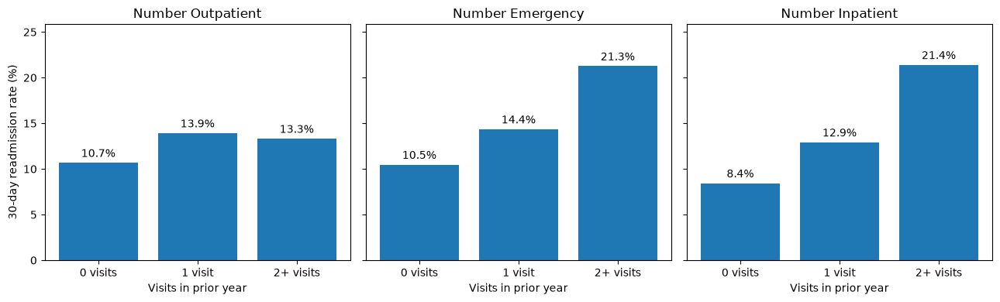
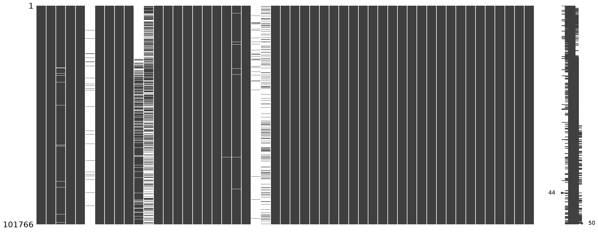
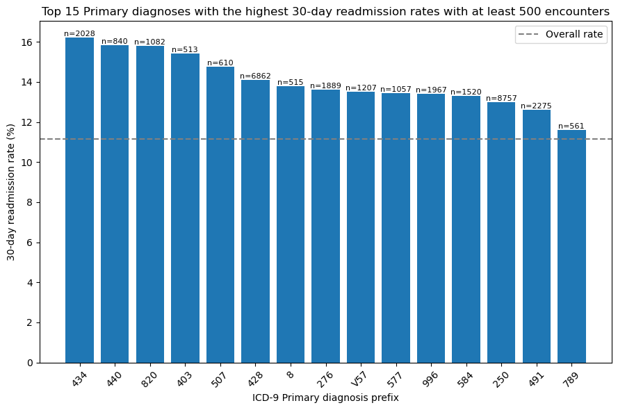
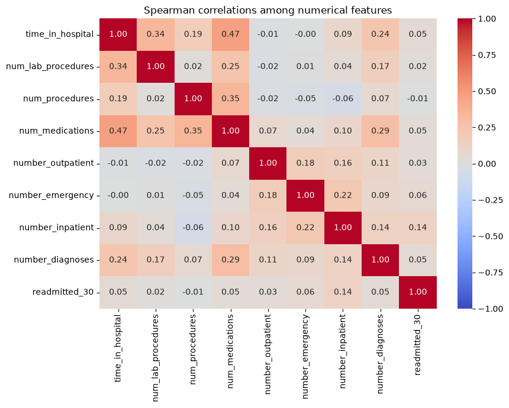

# fall-2026-hospital-readmission-for-diabetes

## Team Details
Team project: fall-2026-hospital-readmission-for-diabetes

Kevin Dao and Taylor Tan  

Erdős Institute Data Science Bootcamp, Fall 2026

**Question:** Can a small, interpretable model predict 30-day hospital readmission for patients with diabetes as well as a baseline logistic regression using all available predictors and minimal preprocessing? 

## Data and outcome

We use the [Diabetes 130-US Hospitals for Years 1999–2008 dataset](https://archive.ics.uci.edu/dataset/296/diabetes+130-us+hospitals+for+years+1999-2008), which contains 101,766 inpatient encounters. A patient may appear in more than one encounter. We label a recorded readmission within 30 days as positive and readmission after 30 days or no recorded readmission as negative. In this dataset, 11.16% of encounters have the positive label.

Cleaning removes the encounter identifier, treats `?` and `NULL` as missing, and maps coded admission and discharge fields to descriptions. The patient identifier is retained to create grouped splits, then excluded from model inputs. Missing predictor values are handled by each model's preprocessing pipeline.

## Evaluation

Each row represents an encounter, and some patients have multiple encounters. We therefore grouped records by patient when making both splits. This keeps encounters from the same person out of different subsets, where shared patient information could otherwise make validation or test performance look more favorable. We used the first split from a five-fold StratifiedGroupKFold to reserve approximately 20% of encounters for testing, then applied the same procedure to divide the development set into training and validation subsets. Stratification attempts to maintain similar proportions of 30-day readmissions while respecting the patient groups.

The resulting training, validation, and test sets contain 65,129, 16,283, and 20,354 encounters, including approximately 7,268, 1,817, and 2,272 positive outcomes. This allocation leaves substantial data for fitting while retaining positive cases for threshold selection and the final comparison. We used validation F2 to develop the seven-input model and select its classification threshold. We selected a threshold for the baseline on the same validation set. We then refitted the light model and baseline on the full 81,412-encounter development set and evaluated them on the test set at those fixed thresholds.

Our main metric is $F_2$-score. For precision $P$ and recall $R$, the $F_2$ is given as $F_2 = \frac{5PR}{4P+R}$. We report precision and recall alongside $F_2$ so the tradeoff between missed readmissions and false alerts remains visible.

## Results

| Model | Source inputs | Validation F2 | Fixed threshold | Test F2 | Test precision | Test recall |
| --- | ---: | ---: | ---: | ---: | ---: | ---: |
| [Baseline logistic regression](results/final/baseline_model.ipynb) | 47 | 0.40878 | 0.06736 | 0.41277 | 13.4% | 85.9% |
| [Light logistic regression](results/final/logistic_regression_light.ipynb) | 7 | 0.42735 | 0.65989 | **0.42477** | 14.7% | 80.8% |

The baseline logistic regression model...

The light model had higher observed test $F_2$. The light model improved test F2 from 0.41277 to 0.42477, an absolute increase of 0.01200. At the selected thresholds, it produced 1,917 fewer false positives while identifying 116 fewer readmissions than the baseline.” This makes the gain and its tradeoff clear.

The light logistic regression model also utilized `payer_code`. During the experimentation process, we saw that models tend to perform better when including this feature. Its predictive association could reflect coverage, access to care, demographics, hospital practices, or other unmeasured factors. However, the provided data does not identify that mechanism.

## Exploratory data analysis and feature selection

Readmission within 30 days occurred for 11,357 of 101,766 encounters, or 11.16%. The figures below describe patterns related to several inputs in the final model.

### Prior hospital use

*Encounters with two or more prior emergency visits had a 21.3% readmission rate. Those with two or more prior inpatient visits had a 21.4% rate, compared with 11.2% overall.* The final model includes `number_emergency` and `number_inpatient` to represent prior use.

### Missing payer information

*Payer code is missing for 40,256 encounters.* The final model includes `payer_code` and represents missing values explicitly during preprocessing. Its association with readmission does not tell us whether insurance coverage or care after discharge explains the pattern. This should be explored further in data collection.

### Primary diagnosis

*Readmission rates vary across the displayed primary diagnosis prefixes, each of which has at least 500 encounters.* The final model uses `diag_1`, with raw diagnosis codes grouped into broader categories before categorical encoding. This is relevant since ICD9 already has groupings by the general condition. We see 434, 440, 403, 428 featuring prominently and they are "Diseases of the Circulatory System".

The other four inputs are `discharge_disposition_id`, `number_diagnoses`, `num_medications`, and `payer_code`. The figures provide context for the selected variables, while the validation results assess the seven-input model as a whole. They do not measure the separate contribution of each variable.

### Correlation among numerical features

*Spearman correlations measure pairwise monotonic associations. They do not measure a feature’s contribution to a fitted model.*

`time_in_hospital` has a weak correlation with 30-day readmission ($\rho \approx 0.05$). It is more closely associated with `num_medications` ($\rho \approx 0.47$) and `num_lab_procedures` ($\rho \approx 0.34$), suggesting that these variables capture some overlapping information about an encounter. Among the numerical variables shown, `number_inpatient` has the strongest correlation with readmission ($\rho \approx 0.14$). This made it reasonable to test a compact model without `time_in_hospital`.

## The Light Logistic Regression Model

The light model uses `number_inpatient`, `number_emergency`, `payer_code`, `discharge_disposition_id`, `diag_1`, `number_diagnoses`, and `num_medications`. Primary diagnosis codes in `diag_1` are grouped into broader categories before the seven inputs are selected. Numerical inputs receive median imputation and standard scaling. Categorical inputs receive a constant `Missing` category and one-hot encoding, with categories occurring fewer than 100 times grouped as infrequent. The fitted logistic regression uses `C=0.2` and class weights `{0: 1, 1: 22}`. Seven source inputs yield more than seven fitted coefficients after categorical encoding.

The saved [`final_model.joblib`](results/final/final_model.joblib) contains the fitted estimator pipeline for these selected inputs. 

**Warning:** Diagnosis grouping and input selection happen **before** that pipeline in the notebook. Apply those same steps before passing new encounters to the saved estimator. Its probability outputs have not been calibrated for clinical use.

## Repository map

| Path | Contents |
| --- | --- |
| `data/` | Original CSV files and prepared development and development/test splits in `cleaned_data/` |
| `models/modeling_data/` | Prepared training and validation splits |
| `models/preprocessing.py` and `models/scoring.py` | Shared data and scoring helpers |
| `models/` | Baseline experiments, comparisons with other models, and tuning of models |
| `notebooks/` | Exploratory analysis and feature-selection notebooks |
| `results/` | Evaluation of models, executive summary, slides |
| `results/final/` | Final baseline and light test notebooks, plus the exported light estimator |

## Limitations and sources

The encounters were recorded from 1999 to 2008. These results do not establish performance at other hospitals or on current patients. Before clinical use, the model would require further external evaluation, probability calibration, checks across patient groups, and an assessment of how many follow-up alerts care teams can act on.

Further modeling work can still be done. For example, separataing based on age groups could lead to better models. We also saw that there were very few admissions based in the age group $[0,10]$ and so models will likely not perform well for that age group.

It is important to also note that the data collection does not include post-dischanrge treatments. The absence of recorded post-discharge care may limit what encounter-only predictors can achieve, but this study does not quantify that limit.

- [UCI dataset description](https://archive.ics.uci.edu/dataset/296/diabetes+130-us+hospitals+for+years+1999-2008)
- Strack, B., et al. (2014). [Impact of HbA1c measurement on hospital readmission rates: analysis of 70,000 clinical database patient records](https://doi.org/10.1155/2014/781670). *BioMed Research International*, 2014, 781670.
